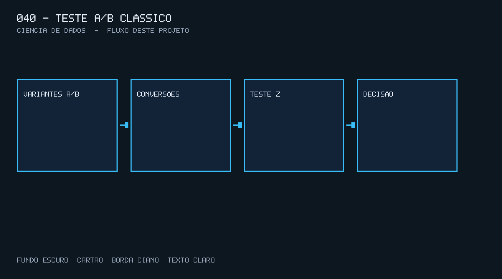

# 040 — Teste A/B clássico

Material educacional de Ciência de Dados. Projeto anterior recomendado: 037. Os clientes, valores e textos deste exercício são fictícios.

## Descrição

Este projeto calcular conversões, diferença absoluta e relativa e um teste de duas proporções. O fluxo local é Variantes A/B → Conversões → Teste z → Decisão.

## Problema

Uma landing nova parece converter mais e o time quer publicar agora.

## Objetivos de aprendizagem

- Praticar A/B, duas proporções, uplift.
- Entregar um artefato JSON (e arquivos auxiliares quando o problema pede) a partir de um CSV sintético.
- Explicar a decisão técnica e a limitação antes de copiar o desenho para um ambiente real.

## Conceitos de Ciência de Dados

A/b, duas proporções, uplift. Nível Intermediário. O código roda offline, com seed quando há aleatoriedade.

## Tecnologias

Python 3.11, pandas, numpy, pytest. Sem conta paga. Docker não é necessário.

## Arquitetura

Variantes A/B → Conversões → Teste z → Decisão.



## Estrutura de diretórios

```text
040-teste-ab/
  src/main.py
  src/engine.py
  tests/test_engine.py
  data/entrada.csv
  assets/architecture.png
  requirements.txt
  .env.example
```

## Pré-requisitos

Python 3.11+ no PATH. Instale as bibliotecas do `requirements.txt`.

## Instalação e configuração

```powershell
cd 040-teste-ab
copy .env.example .env
python -m pip install -r requirements.txt
```

Os caminhos do exemplo apontam para a amostra versionada e para a pasta `out/`.

## Como executar

```powershell
python src/main.py --entrada data/entrada.csv --saida out/resultado.json
```

A CLI responde em português. Arquivo ausente termina com código 1.

## Como validar

```powershell
pytest
```

Os testes cobrem o resultado da função `run` e a CLI com a amostra versionada.

## Exemplos de entrada e saída

A entrada é o CSV sintético em `data/entrada.csv`. A saída é um JSON em `out/resultado.json` com as chaves do problema — por exemplo o resumo, a métrica ou o artefato gerado.

## Decisões técnicas

O motor fica em `src/engine.py` para o `main.py` só cuidar de CLI, log e código de saída. Seed 42 quando há amostragem ou modelo. Dado sintético de propósito, para o exercício ser reproduzível sem rede.

## Limitações

É uma demonstração educacional. Não há serviço em produção, dado pessoal real, monitoramento 24h nem garantia de poder estatístico fora desta amostra.

## Melhorias sugeridas

Trocar o CSV sintético por um extract interno (anonimizado), acrescentar um relatório em HTML e versionar o artefato fora da pasta do exercício.

## Aplicação empresarial

Experimento de checkout.

## Competências para o portfólio

Mostre o problema, a decisão no código e a limitação. Aponte o teste e a imagem de arquitetura desta pasta.
