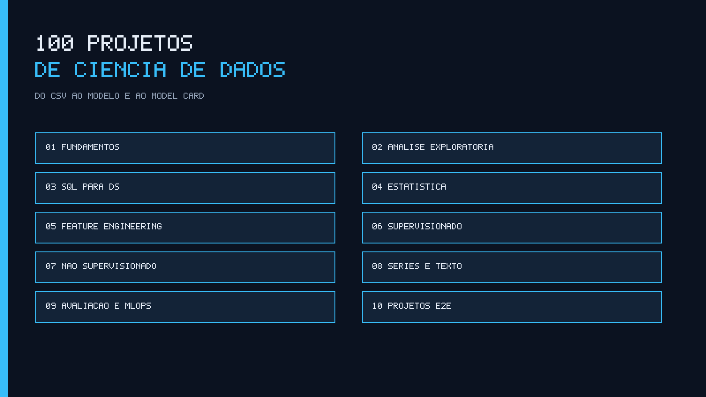
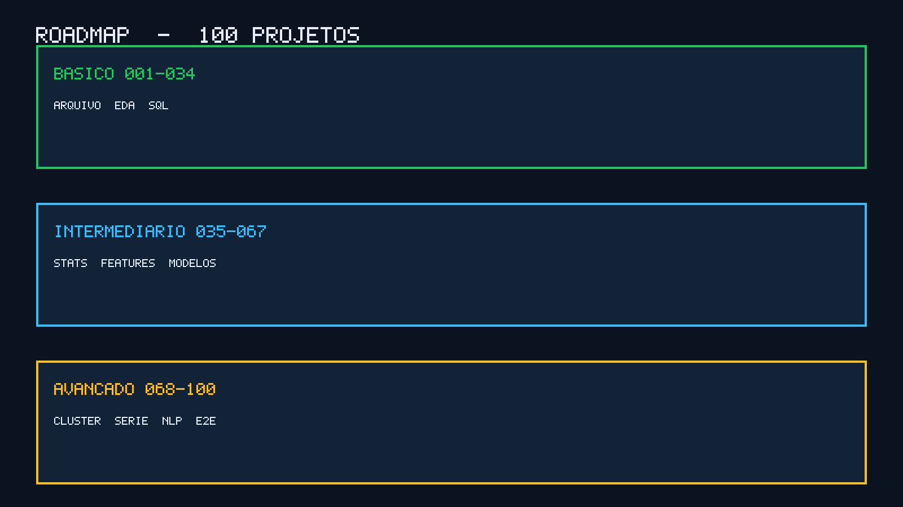

# 100 Projetos de Ciência de Dados



Cem projetos práticos para aprender ciência de dados fazendo: pandas, EDA, SQL, experimento, feature, modelo, cluster, série, texto e um caso de ponta a ponta. Cada pasta é um problema com começo, meio e comando de execução.

Os 100 projetos estão implementados. A suíte local (pytest) e o resultado dos lotes ficam em `batches/`. O quadro de status está em [TASKS.md](TASKS.md) e o fechamento em [RELATORIO-FINAL.md](RELATORIO-FINAL.md). Cada projeto marcado `validado` passou nessa suíte local. Isso não torna o material production-ready.

## Proposta

O material serve para quem quer praticar ciência de dados, montar portfólio e ver como um problema de negócio vira análise, modelo e checagem. Não é uma lista de ideias. Cada número de 001 a 100 tem pasta, enunciado, tecnologias e um anterior recomendado.

A fonte da verdade é [catalog/projects.json](catalog/projects.json). As tabelas abaixo são a visão desse arquivo. Para gerá-las de novo:

```bash
python scripts/generate_catalog.py
```

O script imprime Markdown na saída padrão e não reescreve este README.

## O que você encontra

- 100 projetos numerados, em 10 categorias, do básico ao avançado.
- Um problema curto, um objetivo de aprendizagem e o projeto anterior, quando existe.
- Convenção única de pasta: `README.md`, `src/main.py`, `src/engine.py`, `tests/`, `requirements.txt`, `.env.example` e `assets/architecture.png`.
- Dados sintéticos. Nenhuma API paga.
- Documentação em português e um glossário dos termos usados na trilha.
- Scripts para validar a estrutura e regenerar as tabelas do catálogo.

Os diretórios 001 a 100 estão no disco, um de cada, nos caminhos de [catalog/projects.json](catalog/projects.json).

## Para quem é

- Quem está começando e quer uma ordem, em vez de um tutorial solto.
- Quem já programa e precisa praticar pandas, SQL analítico, experimento e sklearn.
- Quem vai a uma entrevista e quer explicar uma decisão com código que roda.
- Quem adapta um exercício para um protótipo interno, sabendo a distância até produção.

Não é um curso com certificado, nem um atalho para cargo. Também não substitui o critério de um ambiente real: os projetos avançados são demonstrações educacionais, como explica [docs/arquitetura.md](docs/arquitetura.md).

## Como usar

1. Escolha uma trilha em [docs/roadmap.md](docs/roadmap.md) ou um número na tabela abaixo.
2. Leia o projeto anterior indicado no catálogo, se o conceito for novo.
3. Entre na pasta do projeto e siga o README dele. A seção abaixo é o caminho padrão.
4. Ao terminar, olhe limitações e melhorias sugeridas antes de copiar o desenho para outro contexto.

Não é obrigatório fazer os 100 em sequência. É obrigatório respeitar o pré-requisito quando você ainda não viu o conceito.

## Como executar um projeto individual

Na pasta do projeto, o caminho padrão é:

```bash
python -m venv .venv
```

No Windows, PowerShell:

```powershell
.venv\Scripts\Activate.ps1
pip install -r requirements.txt
copy .env.example .env
python src/main.py
pytest
```

No Linux ou macOS:

```bash
source .venv/bin/activate
pip install -r requirements.txt
cp .env.example .env
python src/main.py
pytest
```

O ponto de entrada Python continua sendo `python src/main.py`, e o teste continua sendo pytest. Não há conta paga obrigatória.

Para trabalhar nos scripts desta raiz:

```bash
python -m pip install -r requirements-dev.txt
python scripts/validate_projects.py
```

O validador sai com código 0 só quando os 100 projetos passam.

## Pré-requisitos gerais

- Python 3.11 ou superior
- Git
- pandas, numpy, scikit-learn e matplotlib nos projetos que os listam
- Nenhuma conta paga obrigatória

Detalhe em [docs/tecnologias.md](docs/tecnologias.md).

## Roadmap e organização



A progressão pedagógica e as trilhas com links estão em [docs/roadmap.md](docs/roadmap.md).

| Nível | Projetos | Quantidade | Foco |
|-------|----------|------------|------|
| Básico | 001–034 | 34 | Pandas, EDA e SQL local |
| Intermediário | 035–067 | 33 | Estatística, features e modelos supervisionados |
| Avançado | 068–100 | 33 | Cluster, série, texto, MLOps local e casos completos |

| Pasta | Categoria | Projetos |
|-------|-----------|----------|
| `01-fundamentos` | Fundamentos | 001–010 |
| `02-analise-exploratoria` | Análise exploratória | 011–020 |
| `03-sql-para-ciencia-de-dados` | SQL para ciência de dados | 021–034 |
| `04-estatistica-e-experimentos` | Estatística e experimentos | 035–046 |
| `05-feature-engineering` | Feature engineering | 047–056 |
| `06-aprendizado-supervisionado` | Aprendizado supervisionado | 057–067 |
| `07-nao-supervisionado` | Não supervisionado | 068–076 |
| `08-series-temporais-e-texto` | Séries temporais e texto | 077–086 |
| `09-avaliacao-etica-e-mlops` | Avaliação, ética e MLOps | 087–094 |
| `10-projetos-end-to-end` | Projetos end-to-end | 095–100 |

## Catálogo

Resumo de uma linha. O objetivo, as tecnologias, os conceitos e o projeto anterior estão em [catalog/projects.json](catalog/projects.json).

### 01 — Fundamentos

Projetos 001–010 · Básico

| Nº | Projeto | Nível | Resumo |
|----|---------|-------|--------|
| 001 | [Leitura tabular com pandas](01-fundamentos/001-leitura-tabular/) | Básico | Planilha de vendas chega como CSV e ninguém confere linhas, tipos e encoding. |
| 002 | [Tipos e conversão de colunas](01-fundamentos/002-tipos-e-conversao/) | Básico | Receita, data e quantidade vieram como texto e as somas ficam erradas. |
| 003 | [Valores ausentes](01-fundamentos/003-valores-ausentes/) | Básico | Cadastro de clientes tem nulos em renda, cidade e data de adesão. |
| 004 | [Outliers e IQR](01-fundamentos/004-outliers-e-iqr/) | Básico | Ticket médio explode por alguns pedidos com valor absurdo. |
| 005 | [Datas e períodos](01-fundamentos/005-datas-e-periodos/) | Básico | A série de pedidos mistura fuso, string e datetime e o mês fecha errado. |
| 006 | [Junção de tabelas](01-fundamentos/006-juncao-de-tabelas/) | Básico | Pedidos e clientes vivem em arquivos separados e a análise precisa dos dois. |
| 007 | [Agrupamentos e KPIs](01-fundamentos/007-agrupamentos-e-kpis/) | Básico | A diretoria pede receita, ticket e pedidos por categoria e canal. |
| 008 | [Dados sintéticos controlados](01-fundamentos/008-dados-sinteticos-controlados/) | Básico | Não há base real e o time precisa de um dataset com propriedades conhecidas. |
| 009 | [Reprodutibilidade com seed](01-fundamentos/009-reprodutibilidade-com-seed/) | Básico | O mesmo notebook gera números diferentes a cada execução. |
| 010 | [Perfil estatístico de dataset](01-fundamentos/010-perfil-estatistico/) | Básico | Ninguém sabe assimetria, cardinalidade e intervalo das colunas. |

### 02 — Análise exploratória

Projetos 011–020 · Básico

| Nº | Projeto | Nível | Resumo |
|----|---------|-------|--------|
| 011 | [Distribuições univariadas](02-analise-exploratoria/011-distribuicoes-univariadas/) | Básico | O time discute média de ticket sem olhar a forma da distribuição. |
| 012 | [Correlação e heatmap](02-analise-exploratoria/012-correlacao-e-heatmap/) | Básico | Há dezenas de colunas numéricas e ninguém vê colinearidade. |
| 013 | [Análise bivariada](02-analise-exploratoria/013-analise-bivariada/) | Básico | A pergunta é se clientes premium compram mais, e só existe feeling. |
| 014 | [Tabelas de frequência](02-analise-exploratoria/014-tabelas-de-frequencia/) | Básico | Canais e UFs se repetem e a participação de cada um não está clara. |
| 015 | [Pareto e concentração](02-analise-exploratoria/015-pareto-e-concentracao/) | Básico | A receita parece concentrada em poucos SKUs, mas isso nunca foi medido. |
| 016 | [Comparação de grupos](02-analise-exploratoria/016-comparacao-de-grupos/) | Básico | Marketing quer saber se o canal pago converte diferente do orgânico. |
| 017 | [Mapa de ausência](02-analise-exploratoria/017-mapa-de-ausencia/) | Básico | Nulos não são aleatórios: renda falta mais em uma praça. |
| 018 | [Relatório de EDA em Markdown](02-analise-exploratoria/018-relatorio-eda-markdown/) | Básico | A exploração fica presa no notebook e ninguém herda o achado. |
| 019 | [KPIs de produto](02-analise-exploratoria/019-kpis-de-produto/) | Básico | Produto pede conversão, retenção D7 e ticket e cada um calcula diferente. |
| 020 | [Visualizações exportadas](02-analise-exploratoria/020-visualizacoes-exportadas/) | Básico | Os gráficos só existem na sessão do analista. |

### 03 — SQL para ciência de dados

Projetos 021–034 · Básico

| Nº | Projeto | Nível | Resumo |
|----|---------|-------|--------|
| 021 | [Carga de CSV no SQLite](03-sql-para-ciencia-de-dados/021-carga-csv-sqlite/) | Básico | Analistas precisam consultar vendas em SQL sem servidor. |
| 022 | [SQL analítico de vendas](03-sql-para-ciencia-de-dados/022-sql-analitico-de-vendas/) | Básico | As perguntas de ranking, ticket e mix não cabem em um groupby solto. |
| 023 | [Cohort de retenção](03-sql-para-ciencia-de-dados/023-cohort-de-retencao/) | Básico | Produto não sabe se quem entrou em março continua ativo em junho. |
| 024 | [Funil de conversão](03-sql-para-ciencia-de-dados/024-funil-de-conversao/) | Básico | Visitantes, cadastros e compras existem, mas o funil não fecha. |
| 025 | [RFM em SQL](03-sql-para-ciencia-de-dados/025-rfm-em-sql/) | Básico | CRM pede recência, frequência e valor e a planilha não escala. |
| 026 | [Funções de janela para DS](03-sql-para-ciencia-de-dados/026-funcoes-de-janela/) | Básico | É preciso comparar cada dia com o anterior e com a média móvel. |
| 027 | [Amostragem estratificada em SQL](03-sql-para-ciencia-de-dados/027-amostragem-estratificada-sql/) | Básico | A amostra de treino ignora a mistura de UFs e o modelo enviesa. |
| 028 | [Pivot e unpivot](03-sql-para-ciencia-de-dados/028-pivot-e-unpivot/) | Básico | A tabela larga de meses não serve para um modelo longitudinal. |
| 029 | [Join e vazamento temporal](03-sql-para-ciencia-de-dados/029-join-e-vazamento-temporal/) | Básico | O join com cadastro usa o estado futuro do cliente. |
| 030 | [KPIs versionados em SQL](03-sql-para-ciencia-de-dados/030-kpis-versionados-sql/) | Básico | Cada analista calcula margem com uma regra diferente. |
| 031 | [Features agregadas via SQL](03-sql-para-ciencia-de-dados/031-features-agregadas-sql/) | Básico | O modelo precisa de soma, contagem e recência nos 30 dias anteriores. |
| 032 | [Testes de qualidade em SQL](03-sql-para-ciencia-de-dados/032-qualidade-em-sql/) | Básico | A tabela analítica entra com nulos e duplicatas na chave. |
| 033 | [Views analíticas locais](03-sql-para-ciencia-de-dados/033-views-analiticas/) | Básico | Toda pergunta reescreve o mesmo join de pedidos e itens. |
| 034 | [Dicionário analítico](03-sql-para-ciencia-de-dados/034-dicionario-analitico/) | Básico | Ninguém sabe a unidade, o nulo e o dono de cada coluna. |

### 04 — Estatística e experimentos

Projetos 035–046 · Intermediário

| Nº | Projeto | Nível | Resumo |
|----|---------|-------|--------|
| 035 | [Estatística descritiva robusta](04-estatistica-e-experimentos/035-descritiva-robusta/) | Intermediário | A média de ticket é puxada por poucos pedidos e o relatório mente. |
| 036 | [Intervalo de confiança](04-estatistica-e-experimentos/036-intervalo-de-confianca/) | Intermediário | A conversão da semana é um ponto e a diretoria trata como verdade. |
| 037 | [Teste t de duas amostras](04-estatistica-e-experimentos/037-teste-t/) | Intermediário | Dois canais têm tickets diferentes e ninguém testa se é ruído. |
| 038 | [Teste qui-quadrado](04-estatistica-e-experimentos/038-teste-qui-quadrado/) | Intermediário | Conversão parece depender do dispositivo, mas pode ser acaso. |
| 039 | [Correlação não é causa](04-estatistica-e-experimentos/039-correlacao-nao-e-causa/) | Intermediário | Uma correlação forte é vendida como alavanca de negócio. |
| 040 | [Teste A/B clássico](04-estatistica-e-experimentos/040-teste-ab/) | Intermediário | Uma landing nova parece converter mais e o time quer publicar agora. |
| 041 | [Poder e tamanho amostral](04-estatistica-e-experimentos/041-poder-e-tamanho-amostral/) | Intermediário | O teste foi interrompido com n pequeno e o time declara vitória. |
| 042 | [Bootstrap](04-estatistica-e-experimentos/042-bootstrap/) | Intermediário | A métrica não tem fórmula pronta de erro padrão. |
| 043 | [Mann-Whitney](04-estatistica-e-experimentos/043-mann-whitney/) | Intermediário | O ticket não é normal e o teste t fica difícil de defender. |
| 044 | [CUPED e covariáveis](04-estatistica-e-experimentos/044-cuped/) | Intermediário | O A/B tem muita variância e o efeito some no ruído. |
| 045 | [Testes múltiplos](04-estatistica-e-experimentos/045-testes-multiplos/) | Intermediário | O time olhou 20 recortes e um deles deu significativo. |
| 046 | [Peeking e tamanho fixo](04-estatistica-e-experimentos/046-peeking/) | Intermediário | Alguém olhou o p-valor no meio do experimento e parou. |

### 05 — Feature engineering

Projetos 047–056 · Intermediário

| Nº | Projeto | Nível | Resumo |
|----|---------|-------|--------|
| 047 | [Encoding categórico](05-feature-engineering/047-encoding-categorico/) | Intermediário | UF e canal entram como texto e o modelo não aceita. |
| 048 | [Scaling e normalização](05-feature-engineering/048-scaling-e-normalizacao/) | Intermediário | Renda e idade têm escalas diferentes e a regularização pune a renda. |
| 049 | [Binning e discretização](05-feature-engineering/049-binning/) | Intermediário | Idade contínua não captura faixas de apólice. |
| 050 | [Features de calendário](05-feature-engineering/050-features-de-calendario/) | Intermediário | O modelo trata a data como id e perde sazonalidade. |
| 051 | [Target encoding com CV](05-feature-engineering/051-target-encoding/) | Intermediário | Média do alvo por cidade vaza o próprio rótulo. |
| 052 | [Pipeline sklearn](05-feature-engineering/052-pipeline-sklearn/) | Intermediário | Imputar, escalar e treinar em células soltas quebra na produção. |
| 053 | [Leakage temporal](05-feature-engineering/053-leakage-temporal/) | Intermediário | A feature de 30 dias inclui o dia da predição. |
| 054 | [Seleção de features](05-feature-engineering/054-selecao-de-features/) | Intermediário | Há 40 colunas e várias são ruído ou colineares. |
| 055 | [Interações e polinômios](05-feature-engineering/055-interacoes-e-polinomios/) | Intermediário | O efeito de desconto depende da categoria e o modelo linear não vê. |
| 056 | [Imputação avançada](05-feature-engineering/056-imputacao-avancada/) | Intermediário | Dropar nulos reduz demais o n e a média distorce a cauda. |

### 06 — Aprendizado supervisionado

Projetos 057–067 · Intermediário

| Nº | Projeto | Nível | Resumo |
|----|---------|-------|--------|
| 057 | [Regressão linear](06-aprendizado-supervisionado/057-regressao-linear/) | Intermediário | O time precisa de um modelo explicável de preço. |
| 058 | [Métricas de regressão](06-aprendizado-supervisionado/058-metricas-de-regressao/) | Intermediário | Só o R² é reportado e o erro em reais fica escondido. |
| 059 | [Regressão logística](06-aprendizado-supervisionado/059-regressao-logistica/) | Intermediário | A pergunta é binária — vai churnar? — e a linear não serve. |
| 060 | [Matriz de confusão e threshold](06-aprendizado-supervisionado/060-matriz-e-threshold/) | Intermediário | O limiar 0,5 gera muitos falsos positivos caros. |
| 061 | [Árvore de decisão](06-aprendizado-supervisionado/061-arvore-de-decisao/) | Intermediário | Negócio quer regras legíveis, não só um score. |
| 062 | [Random Forest](06-aprendizado-supervisionado/062-random-forest/) | Intermediário | A árvore única superajusta e a logística subajusta. |
| 063 | [Gradient boosting](06-aprendizado-supervisionado/063-gradient-boosting/) | Intermediário | O residual ainda tem padrão e a floresta saturóu. |
| 064 | [Validação cruzada](06-aprendizado-supervisionado/064-validacao-cruzada/) | Intermediário | O holdout único sorteou um mês fácil e o número ficou otimista. |
| 065 | [Classe desbalanceada](06-aprendizado-supervisionado/065-classe-desbalanceada/) | Intermediário | Fraude é 2% e a acurácia de 98% não serve. |
| 066 | [Curvas ROC e PR](06-aprendizado-supervisionado/066-roc-e-pr/) | Intermediário | O AUC ROC parece bom numa classe rara e engana o comitê. |
| 067 | [Baseline versus modelo](06-aprendizado-supervisionado/067-baseline-vs-modelo/) | Intermediário | O modelo é apresentado sem um bobão para comparar. |

### 07 — Não supervisionado

Projetos 068–076 · Avançado

| Nº | Projeto | Nível | Resumo |
|----|---------|-------|--------|
| 068 | [K-means](07-nao-supervisionado/068-k-means/) | Avançado | Marketing pede segmentos e a base não tem rótulo. |
| 069 | [Elbow e silhouette](07-nao-supervisionado/069-elbow-e-silhouette/) | Avançado | O k foi escolhido no feeling. |
| 070 | [PCA](07-nao-supervisionado/070-pca/) | Avançado | Há colunas demais e o gráfico de segmentos não cabe. |
| 071 | [Clustering hierárquico](07-nao-supervisionado/071-clustering-hierarquico/) | Avançado | O negócio quer uma árvore de grupos, não só k bolas. |
| 072 | [Detecção de anomalias](07-nao-supervisionado/072-deteccao-de-anomalias/) | Avançado | Alguns pedidos são estranhos e não há rótulo de fraude. |
| 073 | [DBSCAN](07-nao-supervisionado/073-dbscan/) | Avançado | Os grupos não são esferas e o K-means parte errado. |
| 074 | [Projeção t-SNE](07-nao-supervisionado/074-projecao-tsne/) | Avançado | O PCA linear não separa visualmente os grupos. |
| 075 | [Segmentação de clientes](07-nao-supervisionado/075-segmentacao-de-clientes/) | Avançado | RFM existe, mas ninguém transformou score em personas acionáveis. |
| 076 | [Tópicos com NMF](07-nao-supervisionado/076-topicos-nmf/) | Avançado | Há milhares de textos de tickets e ninguém lê o tema. |

### 08 — Séries temporais e texto

Projetos 077–086 · Avançado

| Nº | Projeto | Nível | Resumo |
|----|---------|-------|--------|
| 077 | [Decomposição de série](08-series-temporais-e-texto/077-decomposicao-de-serie/) | Avançado | A receita sobe e ninguém separa tendência de sazonalidade. |
| 078 | [Baseline naive e sazonal](08-series-temporais-e-texto/078-baseline-naive/) | Avançado | O forecast sofisticado nunca foi comparado com ontem e com semana passada. |
| 079 | [Previsão rolling](08-series-temporais-e-texto/079-previsao-rolling/) | Avançado | O modelo é treinado uma vez e envelhece em silêncio. |
| 080 | [Backtest temporal](08-series-temporais-e-texto/080-backtest-temporal/) | Avançado | O split aleatório vaza o futuro para o treino. |
| 081 | [Mudança de regime](08-series-temporais-e-texto/081-mudanca-de-regime/) | Avançado | Uma promoção permanente mudou o nível da série e o modelo antigo quebrou. |
| 082 | [Bag of words](08-series-temporais-e-texto/082-bag-of-words/) | Avançado | Tickets de suporte são texto livre e o time só conta volume. |
| 083 | [TF-IDF e similaridade](08-series-temporais-e-texto/083-tfidf-e-similaridade/) | Avançado | Há tickets repetidos e ninguém acha o semelhante. |
| 084 | [Classificação de texto](08-series-temporais-e-texto/084-classificacao-de-texto/) | Avançado | Cada ticket precisa de uma fila e a triagem é manual. |
| 085 | [Sentimento simples](08-series-temporais-e-texto/085-sentimento-simples/) | Avançado | O NPS aberto não é lido e o humor do cliente some. |
| 086 | [Busca por similaridade](08-series-temporais-e-texto/086-similaridade-de-busca/) | Avançado | O analista precisa achar tickets parecidos com uma consulta nova. |

### 09 — Avaliação, ética e MLOps

Projetos 087–094 · Avançado

| Nº | Projeto | Nível | Resumo |
|----|---------|-------|--------|
| 087 | [Data drift](09-avaliacao-etica-e-mlops/087-data-drift/) | Avançado | O modelo em produção vê outra distribuição e ninguém alerta. |
| 088 | [Fairness e disparidade](09-avaliacao-etica-e-mlops/088-fairness/) | Avançado | A taxa de aprovação muda entre grupos e isso não foi medido. |
| 089 | [Importância por permutação](09-avaliacao-etica-e-mlops/089-importancia-por-permutacao/) | Avançado | A importância da árvore favorece variáveis de alta cardinalidade. |
| 090 | [Model card](09-avaliacao-etica-e-mlops/090-model-card/) | Avançado | O modelo vai a comitê sem uso pretendido, limites e métricas. |
| 091 | [Versionamento de modelo](09-avaliacao-etica-e-mlops/091-versionamento-de-modelo/) | Avançado | Há três pickles na pasta e ninguém sabe qual está no ar. |
| 092 | [Monitoramento de predição](09-avaliacao-etica-e-mlops/092-monitoramento-de-predicao/) | Avançado | O score médio caiu e o time só percebeu no mês seguinte. |
| 093 | [Threshold por custo de negócio](09-avaliacao-etica-e-mlops/093-threshold-por-custo/) | Avançado | Precision e recall não estão em reais. |
| 094 | [Retreino versus freeze](09-avaliacao-etica-e-mlops/094-retrain-vs-freeze/) | Avançado | Ninguém sabe se deve retreinar toda semana ou congelar o modelo. |

### 10 — Projetos end-to-end

Projetos 095–100 · Avançado

| Nº | Projeto | Nível | Resumo |
|----|---------|-------|--------|
| 095 | [Churn de ponta a ponta](10-projetos-end-to-end/095-e2e-churn/) | Avançado | Telecom precisa de um fluxo completo: limpeza, modelo e card. |
| 096 | [Previsão de demanda ponta a ponta](10-projetos-end-to-end/096-e2e-demanda/) | Avançado | Varejo quer um forecast semanal com baseline e backtest. |
| 097 | [Credit scoring ponta a ponta](10-projetos-end-to-end/097-e2e-credito/) | Avançado | Uma fintech fictícia precisa de score, fairness e registro. |
| 098 | [Recomendação simples ponta a ponta](10-projetos-end-to-end/098-e2e-recomendacao/) | Avançado | O catálogo precisa de 'quem viu isto viu aquilo' sem motor pesado. |
| 099 | [Tickets de suporte ponta a ponta](10-projetos-end-to-end/099-e2e-tickets/) | Avançado | Atendimento quer tópicos, sentimento e fila sugerida. |
| 100 | [Laboratório local de ciência de dados](10-projetos-end-to-end/100-e2e-laboratorio/) | Avançado | Falta um comando único que limpe, modele, avalie e documente. |


## Tecnologias e conceitos

Python, pandas, numpy, pytest, SQLite, matplotlib e scikit-learn aparecem quando o problema pede. O guia de quando usar cada uma está em [docs/tecnologias.md](docs/tecnologias.md).

Os termos da trilha (leakage, RFM, CUPED, PSI, model card e outros) estão em [docs/glossario.md](docs/glossario.md). A organização de uma pasta e o crescimento por nível estão em [docs/arquitetura.md](docs/arquitetura.md).

## Trilhas de estudo

Cada item aponta para projetos reais do catálogo. A lista comentada está em [docs/roadmap.md](docs/roadmap.md).

- **Primeiros passos com pandas:** [001](01-fundamentos/001-leitura-tabular/), [003](01-fundamentos/003-valores-ausentes/), [007](01-fundamentos/007-agrupamentos-e-kpis/), [009](01-fundamentos/009-reprodutibilidade-com-seed/), [010](01-fundamentos/010-perfil-estatistico/).
- **EDA:** [011](02-analise-exploratoria/011-distribuicoes-univariadas/), [012](02-analise-exploratoria/012-correlacao-e-heatmap/), [015](02-analise-exploratoria/015-pareto-e-concentracao/), [018](02-analise-exploratoria/018-relatorio-eda-markdown/).
- **SQL analítico:** [021](03-sql-para-ciencia-de-dados/021-carga-csv-sqlite/), [023](03-sql-para-ciencia-de-dados/023-cohort-de-retencao/), [025](03-sql-para-ciencia-de-dados/025-rfm-em-sql/), [029](03-sql-para-ciencia-de-dados/029-join-e-vazamento-temporal/).
- **Experimentos:** [036](04-estatistica-e-experimentos/036-intervalo-de-confianca/), [040](04-estatistica-e-experimentos/040-teste-ab/), [041](04-estatistica-e-experimentos/041-poder-e-tamanho-amostral/), [046](04-estatistica-e-experimentos/046-peeking/).
- **Modelagem:** [052](05-feature-engineering/052-pipeline-sklearn/), [057](06-aprendizado-supervisionado/057-regressao-linear/), [059](06-aprendizado-supervisionado/059-regressao-logistica/), [067](06-aprendizado-supervisionado/067-baseline-vs-modelo/).
- **Projeto completo de portfólio:** [095](10-projetos-end-to-end/095-e2e-churn/), [096](10-projetos-end-to-end/096-e2e-demanda/), [097](10-projetos-end-to-end/097-e2e-credito/), [098](10-projetos-end-to-end/098-e2e-recomendacao/), [099](10-projetos-end-to-end/099-e2e-tickets/), [100](10-projetos-end-to-end/100-e2e-laboratorio/).

## Como usar em portfólio

Escolha uma trilha e dois ou três projetos em que você consiga explicar o problema, a decisão e a limitação sem ler o README na hora. Os casos 095 a 100 são os mais próximos de uma entrega completa, desde que os anteriores que eles citam tenham sido estudados.

No repositório ou no README pessoal, aponte a pasta, a imagem de arquitetura e o teste. Diga o que o projeto demonstra e o que ele não cobre.

## Como contribuir

O combinado de pastas, idioma, status e o que não marcar como validado está em [CONTRIBUTING.md](CONTRIBUTING.md).

## Licença e aviso sobre dados

Código e documentação sob a licença MIT, em [LICENSE](LICENSE). Copyright 2026, Awesome Data Engineering BR contributors.

Os exemplos usam dados sintéticos ou fixtures. Não há dado pessoal real. Chaves de exemplo em `.env.example` são fictícias.

## Status real

Cem projetos implementados. Testes locais executados pelos lotes, com o resultado em `batches/lote-01.md` a `batches/lote-10.md`. O catálogo marca cada um como `validado` por essa suíte. A fundação permanece `implementado`.

O material é educacional.
